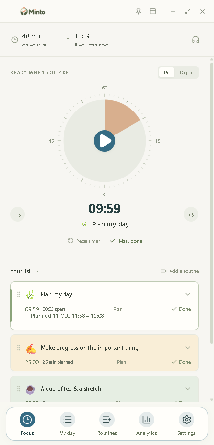
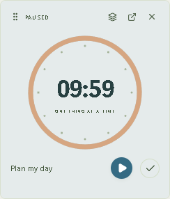

# Minto


Minto is an offline desktop task timer for doing one thing at a time. Add the work you want to do, give each task a duration, and start a countdown. A small floating timer can stay visible beside another desktop app.

Built with Electron, React, and TypeScript. Minto is an independent open-source project inspired by the focused workflow of Llama Life; it is not affiliated with Llama Life and does not use its code or assets.

If you are looking for a simpler alternative to a broad task manager such as TickTick, or a small offline desktop timer inspired by Llama Life's one-task-at-a-time approach, Minto focuses on a daily checklist, a countdown, and a floating timer. It does not offer their wider feature sets.


*Original workflow illustration. The screenshots below show the actual app.*

| Main window                                                  | Floating Orbit timer                                        |
| ------------------------------------------------------------ | ----------------------------------------------------------- |
|  |  |

## What you can do

- **Plan a day:** add, edit, reorder, complete, reopen, and remove tasks. Set an optional planned start, start/end work block, and due date. Plans never start a timer automatically.
- **Focus on one task:** use a pie or digital countdown, pause and resume, adjust by five minutes, or reset a countdown while retaining recorded focus history. Switching tasks preserves each task's progress.
- **Decide at time-up:** the countdown stops at zero. Mark the task done, add five minutes, or explicitly continue in overtime. An optional system chime and desktop notification can call your attention to the decision.
- **Keep time in view:** open a separate draggable mini timer, optionally keep it on top, and choose Pocket, Slice, Task card, Orbit, Desk clock, or Ribbon. Its location and selected style are remembered.
- **Reuse routines:** create local templates of 1–20 tasks and add fresh copies whenever needed. Four built-in starter ideas are also available.
- **Review your work:** the Analytics page shows daily focused time, planned blocks, missed or partly focused blocks, starts and deadlines, completion timing, and a focus timeline.
- **Make it yours:** choose primary and secondary colors, use a palette, toggle brief completion feedback, and optionally play generated ambient brown noise.
- **Own your data:** work stays on this computer. Export a JSON backup, or use the confirmed **Clear all data** action in Settings to start over.

Minto has no account, onboarding, subscription, AI feature, cloud sync, telemetry, notes, or calendar integration. Normal use does not need an internet connection.

## Install and run

On Windows, download the [latest Minto release](https://github.com/KamranProjects/minto/releases/latest). Choose **Setup** for a normal installation or **Portable** to run Minto without installing it. Neither requires Node.js. The downloads are currently unsigned, so Windows may ask you to confirm the publisher warning.

On macOS, use the **arm64 DMG** for Apple Silicon or the **x64 DMG** for an Intel Mac from the same release. The Mac builds passed automated tests on a macOS runner, but they are unsigned and unnotarized, so macOS may block them. These downloads also do not require Node.js.

To run from source, use Node.js **22.16 or newer** and npm. On Windows, from the project folder:

```sh
npm ci
npm run dev
```

`npm run dev` compiles the Electron main process, starts the local Vite server on `127.0.0.1:5173`, and opens the desktop window. Leave that command running while testing. React changes reload automatically; restart it after changing `electron/` or shared timer code. `npm run dev:web` opens only a separate browser design preview and cannot test the native dock, on-top behavior, or notifications.

To run a local production build:

```sh
npm run build
npm start
```

To create Windows installer and portable downloads:

```sh
npm run package:win
```

Find `Minto-Setup-<version>-x64.exe` and `Minto-Portable-<version>-x64.exe` in `release/`. Neither download requires Node.js. These builds are unsigned, so Windows may show a publisher warning. They include Electron, the compiled app in `app.asar`, and only Electron's English locale. Build tools are excluded from the app; keep dev dependencies installed while building. A [manual macOS workflow](.github/workflows/macos-dmg.yml) tests and builds unsigned `.dmg` files on a Mac runner before they are added to a release.

## Using Minto

1. Add a task and choose its duration (1–1,440 minutes). Emoji and task color are optional.
2. Select the task and start the countdown. The current task appears in the main window and mini timer.
3. Pause whenever you step away. When the time reaches zero, choose what happens next; waiting does not add focus time.
4. Mark the task done to select the next unfinished task, paused. Use **My day** to review the list and **Analytics** to review a day.

Closing the main window while the mini timer is open hides the main window; **My list** on the dock restores it. Closing the dock brings back the main window. The timer pauses on computer sleep, app exit, and restart. Unfinished tasks remain on the list until you change them.

| Shortcut       | Action                                                        |
| -------------- | ------------------------------------------------------------- |
| `Space`        | Start or pause when you are not typing or focused on a button |
| `N`            | Add a task                                                    |
| `Ctrl+Shift+D` | Open the mini timer (`Cmd+Shift+D` on macOS)                  |
| `Escape`       | Cancel task editing                                           |

Task reordering also has keyboard-accessible Up/Down controls. Motion is reduced when the operating system requests it.

## Local data and backups

Development and `npm start` use `.cozy-dev/` in the project. The packaged Windows app uses `%APPDATA%\Cozy Focus` to retain data from earlier builds. Set `COZY_DATA_DIR` to an absolute directory when testing with a disposable profile.

The current state is `focus.json`; `focus.json.bak` is its last-known-good recovery copy. Saves are validated and written through flushed temporary files followed by atomic renames. If the primary file is damaged, Minto attempts to recover from the backup and preserves the damaged original. If both are unreadable, startup stops instead of replacing them. The app does not encrypt local data.

**Export a backup** in Settings writes a paused JSON snapshot to a file you choose. To restore it, close Minto, keep a copy of the current files, and place the exported JSON at `focus.json` in the relevant data directory. Minto validates it on the next launch. **Clear all data** resets tasks, routines, analytics, and preferences after you type `RESET`; it also replaces the recovery backup. It cannot be undone unless you exported a copy first.

## Contributing and verification

```sh
npm run typecheck
npm test
npm run test:electron
npm run format:check
```

The Electron smoke test uses a disposable profile under `.test-output/`, exercises both windows, and saves screenshots there. It does not replace your development tasks. See [the developer guide](docs/DEVELOPER.md) for architecture, data and timer contracts, IPC, packaging, tests, and troubleshooting. See [CONTRIBUTING.md](CONTRIBUTING.md) and [AGENTS.md](AGENTS.md) before changing the product behavior.

## Licensing and assets

Minto's code is [MIT licensed](LICENSE). The checked-in Minto logo and icon are project assets. `public/fonts/FlameBold.ttf` is a locally supplied font whose redistribution license was not provided; it is ignored by Git and excluded from the portable package. Packaged builds use the system-font fallback unless a redistributable font is supplied.
